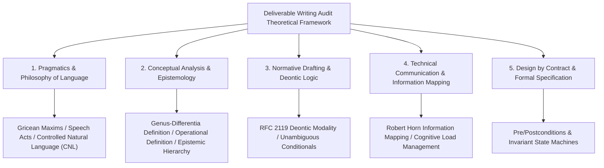

# Methodology Grounding for Deliverable Writing Audit

Every symptom in the catalog originated from recurring corrections in real development sessions, not from top-down theoretical deduction. **This document is a post-hoc mapping**: it aligns each empirically discovered symptom with established theoretical frameworks to identify which known failure mechanism it instantiates.

This mapping serves two purposes: providing an analytical reference when adjudicating boundary cases, and checking whether a proposed new symptom is merely a surface variant of an existing one. **Theoretical mapping does not inflate the evidence strength of any symptom**—tier assignments remain governed by correction frequency and severity, as stated in the evidence disclosure note in [SKILL.md](../SKILL.md).

The five theoretical pillars and their per-symptom mappings follow.

---

## Five Theoretical Pillars

---

### 1. Philosophy of Language and Pragmatics

Pragmatics studies how meaning is transmitted in context. This suite draws on three core frameworks:

1. **Grice's Cooperative Principle and Maxims**:
   - **Maxim of Quality** (**Truthfulness and Evidence**): Assert only propositions supported by adequate evidence; never state what you know to be false or lack evidence for. Maps to: `A3 Unverified Success Claim`, `A4 Residual Unverified Status`, `C6 Speculative Filling`.
   - **Maxim of Quantity** (**Precision of Information Volume**): Make your contribution as informative as required for the current purpose, neither injecting historical noise nor omitting critical boundaries. Maps to: `B1 Change Narration and Before/After Comparison`, `B2 Parenthetical Gloss`, `C9 Navigation Carrying Target Content`.
   - **Maxim of Relation (Relevance)** (**Contextual Focus**): Every sentence must serve the current section's topic and task boundary. Maps to: `B6 Heading-Scope Mismatch`, `D4 Excessive Domain Implementation Detail`.
   - **Maxim of Manner** (**Clarity, Brevity, and Order**): Avoid obscurity, ambiguity, and redundant restatement. Maps to: `B4 Heading Echo`, `D1 Vague Quantifiers and Filler Words`.

2. **Speech Act Theory (Austin & Searle)**:
   - Language does not merely describe states of affairs (**Constatives**); it also enacts obligations and constrains behavior (**Performatives / Directives**).
   - **Separation of Normative Force**: A specification must cleanly separate objective factual descriptions, zero-discretion directives, and context-dependent criteria without blurring the boundary of agent discretion.

3. **Controlled Natural Language (CNL)**:
   - Originating in high-reliability engineering specifications such as ASD-STE100 (Simplified Technical English), CNL eliminates polysemy through restricted vocabulary and deterministic syntax.
   - **One Concept, One Term**: Every domain entity maintains a single canonical designation across the entire repository. Maps to: `C3 Revived Retired Terminology`, `C11 Multiple Terms for One Concept`.

---

### 2. Conceptual Analysis and Epistemology

Epistemology and conceptual analysis govern how concepts are defined and how knowledge boundaries are drawn:

1. **Definition by Genus and Differentia**:
   - Formula: $\text{Definition} = \text{Proximate Genus (Parent Category)} + \text{Specific Differentia (Distinguishing Invariant)}$.
   - Strictly prevents **Circular Definitions (Tautologies)** and definitions that are too broad or too narrow. Every domain concept must identify its parent class and the specific invariant that separates it from sibling concepts.

2. **Operational Definition (P. W. Bridgman)**:
   - If a concept or requirement cannot be stated in terms of **observable, repeatable verification steps and expected outputs**, it cannot be objectively audited or accepted.
   - Maps to: `C1 Unevidenced Capability Limitation Claim`, `C2 Unstructured Prose for Enumerable Facts`, `C12 Tautological and Non-Operational Definitions`.

3. **Epistemic Status Hierarchy**:
   - Enforces a strict hierarchy: **Verified Fact > Testable Hypothesis > Ungrounded Speculation**.
   - Specifications must never leave unverified epistemic states (`"should work"`, `"presumably supported"`, `"TBD"`) standing as normative claims.

---

### 3. Normative Drafting and Deontic Logic

Legal drafting and protocol standardization (IETF RFC 2119 / RFC 8174) require deterministic rule phrasing:

1. **Deontic Modality**:
   - **Obligation (`MUST`)**: Unconditional requirement with zero exceptions.
   - **Prohibition (`MUST NOT`)**: Absolute prohibition.
   - **Criterion (`SHOULD` / Context-Dependent Judgement)**: Governed by an explicit decision criterion (`The criterion is "..."`), requiring documented rationale when an exception applies.
   - **Permission (`MAY`)**: Full discretionary freedom.
   - Within this Skill suite, these map to the strict binary separation between `[Hard Constraint]` and `Criterion`.

2. **Syntactic Unambiguity Principle**:
   - Conditional clauses (`IF` / `WHEN`) must bind directly to the main imperative clause without dangling modifiers or hedged qualifiers.

---

### 4. Technical Communication and Information Architecture

Manages cognitive load for both human readers and LLM agents:

1. **Information Mapping (Robert E. Horn)**:
   - **Chunking**: Partition information into high-cohesion, self-contained functional units.
   - **Self-Evident Labeling**: Guide attention with semantic headings that match the exact scope of their body text, eliminating empty transitional filler.
   - **Information Typing**: Strictly separate principles, procedures, facts, concepts, and examples rather than mixing historical narrative into normative rules.

2. **Cognitive Load and Progressive Disclosure**:
   - Top-level entrypoints (`SKILL.md`) carry only routing logic and core invariants; deep rules (`references/`) load on demand so the Context Window is not flooded. Maps to: `C9 Navigation Carrying Target Content`, `C4 Scattered Duplicate Rules`.

---

### 5. Design by Contract and Formal Specification (Bertrand Meyer)

Models engineering discipline and specification governance as rigorous state-transition contracts:

1. **Preconditions**: States that must hold before an action executes (e.g., an authorizing user verb, an active work item, a verified upstream schema).
2. **Postconditions**: Verifiable states guaranteed to hold after an action completes (e.g., preserved verbatim evidence, closed-loop reporting).
3. **Invariants**: Hard constraints that must never be violated across any state transition (e.g., no irreversible deletion, zero secret leakage, zero speculation).

---

## Theoretical Pillars to 28-Symptom Mapping Matrix

| Symptom Group | ID and Canonical Symptom Name | Primary Theoretical Pillar | Violated Academic / Engineering Principle |
| :--- | :--- | :--- | :--- |
| **A. Security & Credibility** | A1 Secret and Credential Leakage | Design by Contract (Invariants) | Violates system security invariant |
| | A2 AI Attribution Signature | Controlled Natural Language / Information Purity | Injects non-functional metadata noise into deliverables |
| | A3 Unverified Success Claim | Gricean Maxim of Quality / Operational Definition | Asserts a proposition lacking operational verification evidence |
| | A4 Residual Unverified Status | Epistemic Status Hierarchy | Leaves an unresolved epistemic state in a normative table |
| | A5 Local Absolute Path | Design by Contract (Invariants) | Breaks environment independence and portability |
| **B. Formal Noise** | B1 Change Narration and Before/After Comparison | Gricean Maxim of Quantity / Information Mapping | Conflates historical change log with current specification state |
| | B2 Parenthetical Gloss | Controlled Natural Language (CNL) | Fragments syntactic structure and interrupts primary reading flow |
| | B3 Residual Note-to-Self | Information Mapping (Chunking) | Leaks unclosed working-draft state into deliverables |
| | B4 Heading Echo | Gricean Maxim of Manner / Quantity | Redundant paraphrase adding zero-information cognitive load |
| | B5 Self-Describing Metadiscourse | Progressive Disclosure | Meta-commentary lacking operational value |
| | B6 Heading-Scope Mismatch | Information Mapping (Labeling) | Semantic label extension mismatches body content |
| **C. Semantic Comprehension** | C1 Unevidenced Capability Limitation Claim | Operational Definition / Gricean Quality | Asserts a negative capability proposition without exhaustive testing |
| | C2 Unstructured Prose for Enumerable Facts | Information Mapping (Chunking) | Compresses enumerable state matrix into unparsed prose |
| | C3 Revived Retired Terminology | Controlled Natural Language (CNL) | Violates One Concept, One Term principle |
| | C4 Scattered Duplicate Rules | Single Source of Truth (SSOT) / Progressive Disclosure | Multi-location maintenance causing rule drift |
| | C5 Summarized Away Verbatim Error | Operational Definition / Evidence Closure | Destroys primary observational data required for debugging |
| | C6 Speculative Filling | Epistemic Status Hierarchy / Gricean Quality | Substitutes subjective guessing for verified source schema |
| | C7 Developer Jargon Leaked into Deliverables | Pragmatic Context Matching | Mismatches terminology register to target audience |
| | C8 Project-Specific Facts Leaked into Shared Rules | Conceptual Analysis (Genus vs. Instance) | Mistakes a project-local instance for a universal category |
| | C9 Navigation Carrying Target Content | Progressive Disclosure | Conflates routing table responsibility with canonical content |
| | C10 Cross-File Inconsistency | Deontic Logic (Consistency) | Holds mutually contradictory normative claims across files |
| | C11 Multiple Terms for One Concept | Controlled Natural Language (CNL) | Uncontrolled synonym drift breaking cross-reference |
| | C12 Tautological and Non-Operational Definitions | Genus-Differentia / Operational Definition | Circular restatement lacking repeatable verification steps |
| | C13 Deontic Modality Confusion | Deontic Logic (RFC 2119) | Mismatches modal obligation strength to risk reversibility |
| **D. Density & Formatting** | D1 Vague Quantifiers and Filler Words | Controlled Natural Language / Operational Definition | Replaces measurable criteria with unexecutable hedges |
| | D2 Emoji Density | Information Mapping Purity | Visual noise competing with structural hierarchy |
| | D3 Period Inside Bold List Label | Typographic Semantics | Premature terminal punctuation breaking label-to-clause binding |
| | D4 Excessive Domain Implementation Detail | Gricean Maxim of Relation (Relevance) | Exceeds cognitive scope of the target review audience |
