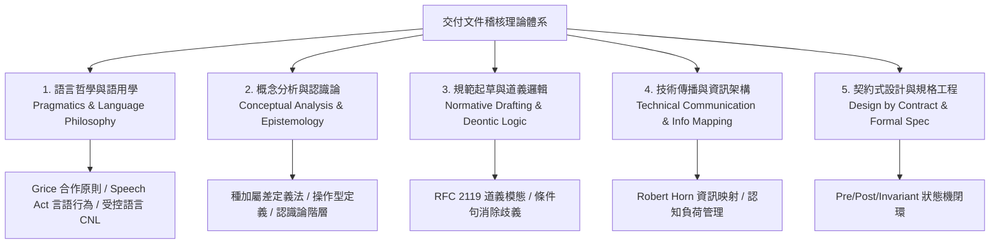

# 交付文件稽核的理論基礎 (Methodology Grounding)

徵狀目錄的每一條都來自實際開發對話中反覆發生的糾正，不是從理論推導出來的。**本文件是事後對照**：把既有的徵狀逐條映射到已發表的理論框架上，看它們各自對應到哪一種既知的失效機制。

映射的用途有二：判讀邊界案例時多一個參照，以及新增徵狀時檢查它是不是某條既有徵狀的變形。**映射不提高任何徵狀的證據強度**——分層依據仍是糾正的頻率與語氣強度，見 [SKILL.md](../SKILL.md) 的證據強度聲明。

五大理論支柱與逐條對應如下。

---

## 五大理論支柱

---

### 一、語言哲學與語用學 (Linguistics & Pragmatics)

語用學研究語言在特定脈絡下的真實意義傳遞。本套件借鑒三個核心概念：

1. **格萊斯合作原則 (Grice's Cooperative Principle & Maxims)**：
   - **質的準則 (Quality)**：**誠實與證據**。只陳述有充分證據支持的結論，不說自知為虛假或未經查證的話。對應徵狀：`A3 假成功宣稱`、`A4「未實測」殘留`、`C6 臆測填空`。
   - **量的準則 (Quantity)**：**適量與精準**。提供的資訊量恰如所需，不塞入多餘雜訊，亦不遺漏關鍵邊界。對應徵狀：`B1 流水帳`、`B2 括號補述`、`C9 導覽夾帶內容`。
   - **關聯準則 (Relevance)**：**脈絡聚焦**。每一句話必須服務當前主題與任務邊界。對應徵狀：`B6 標題與內容不相稱`、`D4 domain 細節過深`。
   - **方式準則 (Manner)**：**簡潔有序，消滅歧義**。避免晦澀表達與換句話說的重複。對應徵狀：`B4 標題回音`、`D1 模糊量詞與填充詞`。

2. **言語行為理論 (Speech Act Theory - Austin & Searle)**：
   - 語言不只是「描述事實」（Constatives），亦用於「規範與約束行為」（Performatives / Directives）。
   - **規範語意分離**：文件必須清晰區分「客觀狀態事實」、「指令約束」與「情境判準」，不可將裁量權模糊化。

3. **受控自然語言 (Controlled Natural Language, CNL)**：
   - 源於高風險工程（如 ASD-STE100），透過受限詞彙與明確語法消除自然語言的多義性。
   - **單一概念單一名詞 (One Concept, One Term)**：同一實體在全系統內維持唯一指稱。對應徵狀：`C3 已退役術語復活`、`C11 同一概念多個名字`。

---

### 二、概念分析與認識論 (Conceptual Analysis & Epistemology)

認識論與概念分析解決「如何精確定義事物」與「如何劃定知識邊界」：

1. **種加屬差定義法 (Definition by Genus and Differentia)**：
   - 公式：$\text{定義} = \text{鄰近的屬 (Genus)} + \text{種差 (Differentia)}$。
   - 嚴格防範**同義反覆 (Circular Definition)** 與定義過寬/過窄。概念必須明確指出上位類別與使它區別於同類的核心特徵。

2. **操作型定義 (Operational Definition - Bridgman)**：
   - 一個概念或要求若無法給出「可觀察、可測量、可重複檢驗的操作步驟」，它就無法被客觀驗收。
   - 對應徵狀：`C1 無證據的能力限制宣稱`、`C2 該結構化卻寫成流水句`。

3. **認識論狀態階層 (Epistemic Status)**：
   - 嚴格區分：**已驗證事實 (Verified Fact) > 待查驗假說 (Hypothesis) > 無依據臆測 (Speculation)**。
   - 規範文件中禁止「應該可以」、「推測可行」等未驗證狀態殘留。

---

### 三、規範起草學與道義邏輯 (Normative Drafting & Deontic Logic)

法律起草與規格標準化（IETF RFC 2119 / RFC 8174）要求規則文字具備確定性：

1. **道義邏輯模態 (Deontic Modality)**：
   - **義務 (MUST / 必須)**：無例外強制執行。
   - **禁止 (MUST NOT / 不得)**：絕對禁止行為。
   - **判準 (SHOULD / 依情境判斷)**：依明確判定條件執行，有例外需記錄理由。
   - **允許 (MAY / 可)**：完全自由裁量。
   - 在 Skill 規範中，對應【硬約束】與【判準】的嚴格二元分級。

2. **句法無歧義原則**：
   - 條件子句（IF / WHEN）必須與主句約束直接相連，不可存在懸空修飾語 (Dangling Modifiers)。

---

### 四、技術傳播與資訊架構 (Technical Communication & Info Mapping)

管理讀者（人或 Agent 模型）的認知負荷：

1. **資訊映射理論 (Information Mapping - Robert E. Horn)**：
   - **區塊化 (Chunking)**：將資訊切分為高內聚的獨立單元。
   - **標籤自明性 (Labeling)**：以具備語意的標題引導，去除無實質意義的填充過渡。
   - **資訊分型**：嚴格分離原理、流程、事實、概念與案例。

2. **認知負荷與漸進揭露 (Progressive Disclosure)**：
   - 頂層入口（`SKILL.md`）僅提供路由與核心約束摘要；深層細節（`references/`）按需載入，避免塞爆 Context Window。對應徵狀：`C9 導覽夾帶內容`、`C4 規則重複散落`。

---

### 五、契約式設計與規格工程 (Design by Contract - Bertrand Meyer)

將工程行為與規範約束定義為嚴謹的狀態轉換契約：

1. **前置條件 (Preconditions)**：動作執行前必須滿足的狀態（如：授權動詞、工項已建立、Schema 已取得）。
2. **後置條件 (Postconditions)**：動作執行後必定成立且可驗證的狀態（如：證據已留存、回報已閉環）。
3. **不變量 (Invariants)**：跨越所有動作與流程永遠不得破壞的硬約束（如：不可復原刪除禁令、機敏不外洩、零臆測）。

---

## 理論支柱與 28 條徵狀映射矩陣

| 徵狀組別 | 徵狀代號與名稱 | 核心理論支柱 | 違反之學術/工程原則 |
| :--- | :--- | :--- | :--- |
| **A. 資安與可信度** | A1 機敏值外洩 | 契約式設計 (Invariants) | 破壞系統安全不變量 |
| | A2 AI 署名 | 受控語言 / 資訊純度 | 引入與產出無關之元資訊 (Metadata Noise) |
| | A3 假成功宣稱 | Grice 質的準則 / 操作型定義 | 陳述缺乏操作型證據之虛假命題 |
| | A4「未實測」殘留 | 認識論階層 (Epistemic Status) | 懸空狀態未收斂至確定態 |
| | A5 本機絕對路徑 | 契約式設計 (Invariants) | 破壞環境無關性與可移植性 |
| **B. 形式雜訊** | B1 流水帳與比較新舊 | Grice 量的準則 / 資訊映射 | 混淆歷史歷程與當前規範之資訊分型 |
| | B2 括號補述 | 受控自然語言 (CNL) | 句法結構碎裂，破壞主幹閱讀流 |
| | B3 個人註記殘留 | 資訊映射 (Chunking) | 草稿未收斂狀態外洩 |
| | B4 標題回音 | Grice 方式準則 / 量的準則 | 同義反覆，增加無效認知負荷 |
| | B5 文件描述自己 | 漸進揭露 (Progressive Disclosure) | 元敘述缺乏操作意義 |
| | B6 標題與內容不相稱 | 資訊映射 (Labeling) | 語意標籤與內容外延不一致 |
| **C. 語意理解** | C1 無證據的能力限制宣稱 | 操作型定義 / Grice 質的準則 | 未經窮舉檢驗即斷言否定性命題 |
| | C2 該結構化卻寫成流水句 | 資訊映射 (Chunking) | 列表資訊未結構化 |
| | C3 已退役術語復活 | 受控自然語言 (CNL) | 破壞單一概念單一名詞原則 |
| | C4 規則重複散落 | 單一事實來源 (SSOT) / 漸進揭露 | 多頭維護導致認知不一致 |
| | C5 摘要掉錯誤原文 | 操作型定義 / 證據閉環 | 丟失除錯所需的完整觀察數據 |
| | C6 臆測填空 | 認識論階層 / Grice 質的準則 | 以主觀猜測頂替客觀事實 |
| | C7 開發者術語滲入交付物 | 語用學脈絡 (Context Matching) | 交付對象語境錯位 |
| | C8 專案特定事實滲入通用規範 | 概念分析 (Genus vs Instance) | 將專案實例誤當通用類別 |
| | C9 導覽夾帶內容 | 漸進揭露 (Progressive Disclosure) | 入口層與細節層職責混淆 |
| | C10 跨檔不一致 | 道義邏輯 (Consistency) | 系統內存在互斥之規則主張 |
| | C11 同一概念多個名字 | 受控自然語言 (CNL) | 同義詞過度擴散破壞檢索性 |
| | C12 同義反覆與非操作型定義 | 種加屬差定義法 / 操作型定義 | 循環反覆缺乏可判定之操作檢驗步驟 |
| | C13 道義模態混淆 | 道義邏輯 (RFC 2119) | 硬約束與情境判準之約束強度錯配 |
| **D. 密度與版式** | D1 模糊量詞與填充詞 | 受控自然語言 / 操作型定義 | 缺乏可量測之判定標準 |
| | D2 emoji 密度 | 資訊映射純度 | 視覺雜訊干擾結構化讀取 |
| | D3 條列標籤用句號 | 排版語意學 (Typography) | 標籤與內容斷句邏輯錯位 |
| | D4 domain 細節過深 | 語用學關聯準則 (Relevance) | 超出目標讀者認知邊界 |
